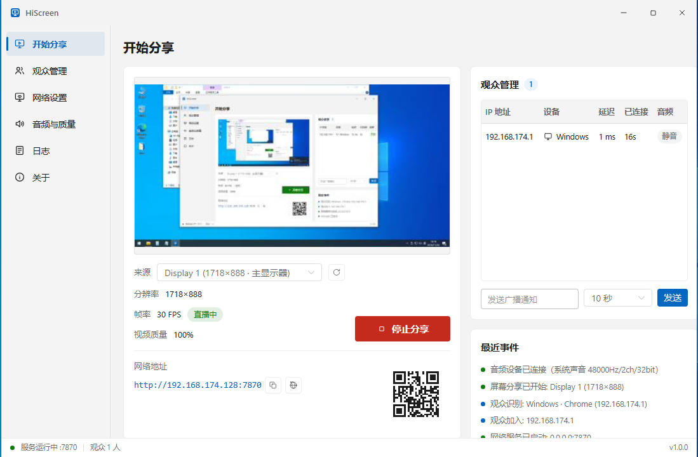
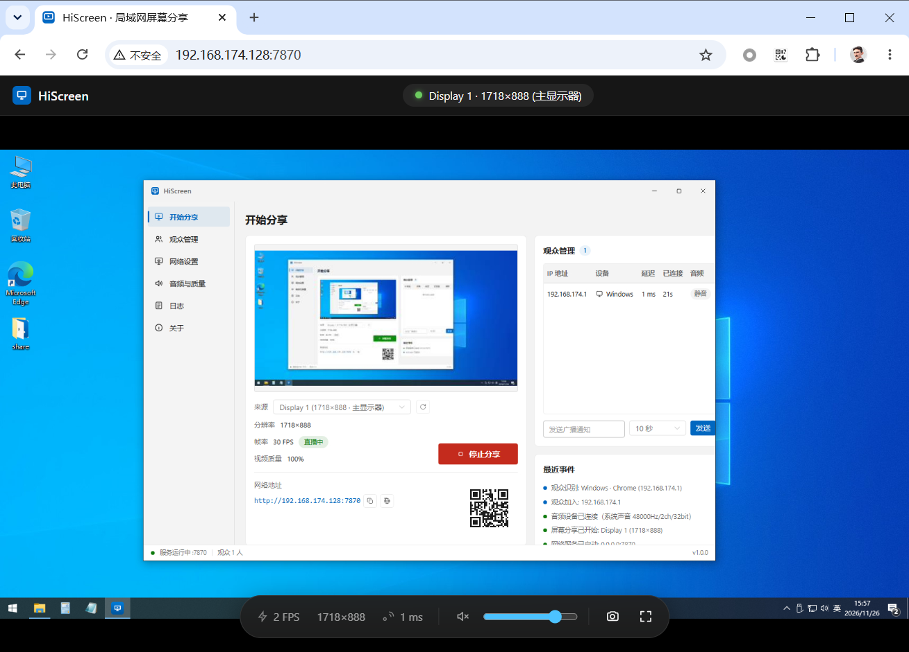

<div align="center">

# HiScreen

**Rust + Tauri 2 + Vue 3 打造的局域网屏幕分享工具**

主机选择任意屏幕开始分享 · 观众用浏览器扫码即看 · 系统声音同步 · 观众管理 · 跨平台（Windows / macOS / Linux）


</div>

<div align="center">

## 界面预览

**主机端**（选择显示器 · 实时预览 · 地址 / 二维码）



**观众端**（浏览器打开 `http://主机IP:7870` 即看，无需安装客户端）



</div>

---

## 简介

HiScreen 是一款局域网屏幕分享软件：主机运行本程序，选择要分享的显示器并点击「开始分享」，同一局域网内的任何设备（手机 / 平板 / 电脑）用浏览器访问 `http://主机IP:7870` 即可实时观看画面与收听系统声音，无需安装任何客户端。

## ✨ 功能特性

**屏幕分享**

- 🖥️ **多显示器选择**：枚举所有物理显示器（分辨率 / 主显示器标记），选择任意一块开始分享，分享中可实时切换
- 🌐 **浏览器观看**：观众页零依赖（HTTP + WebSocket 自包含页面），视频 JPEG 帧流 + 音频 PCM 流，自动重连
- 🔊 **系统声音分享**：Windows 通过 WASAPI loopback 采集系统声音；macOS / Linux 优先取 PulseAudio/PipeWire monitor 源（否则麦克风）
- 🎛️ **画质可调**：视频质量（JPEG 质量 10–100%）与目标帧率（10–60 FPS）实时生效，无需重启分享
- 🖱️ **鼠标光标分享**：可开关的鼠标光标叠加（Windows 采集时合成进视频帧，观众可见光标移动）
- 📱 **扫码即看**：主机 UI 内嵌二维码，手机扫码直达观众页

**观众管理**

- 👥 **实时观众列表**：设备系统 / 浏览器 / 延迟（RTT）/ 已连接时长 / 音频开关状态
- 📢 **广播通知**：主机发送文字通知，所有观众页弹横幅提示，可指定停留时长（5 秒 ~ 60 分钟）
- ⛔ **断开观众**：单独踢除任意观众连接

**网络与运维**

- 🧱 **防火墙手工配置**：应用不修改系统防火墙；网络设置页提供指引，观众连不上时按提示手工放行端口
- 📝 **事件日志**：服务启动 / 观众进出 / 分享状态变化全程留痕，支持清空
- ⚙️ **设置持久化**：端口 / 画质 / 帧率 / 音频 / 自动开始分享等全部保存于 `config.json`

**界面（继承脚手架基座）**

- 🪟 无边框 Fluent 窗口（自绘标题栏 / 侧边栏导航 / 状态栏），浅色 / 深色主题，简体中文 / English i18n
- 💬 右下角 Fluent toast 反馈，弹窗统一 `DialogCard` 基座（拖拽 / 缩放）

## 🛠️ 技术栈与实现

| 层 | 技术 |
|---|---|
| 桌面壳 | Rust、Tauri 2、tauri-plugin-opener |
| 前端 | Vue 3 `<script setup>`、TypeScript strict、Vite 7、Naive UI 2.x、vue-i18n 11 |
| 屏幕采集 | scrap 0.5（Windows DXGI / macOS CoreGraphics / Linux X11） |
| 视频编码 | jpeg-encoder（BGRA → JPEG，质量可调） |
| 音频采集 | Windows WASAPI loopback（windows crate 直调）；Unix 平台 cpal |
| 分发服务 | tokio + axum（HTTP 静态页 + WebSocket 双向流） |

推流协议：WebSocket 二进制帧，首字节为类型（`1`=JPEG 视频，`2`=i16 48kHz 单声道 PCM 音频，20ms 分片）；控制面为 JSON 文本帧（meta / notice / ping-pong / stats）。

## 📦 环境要求

| 依赖 | 版本 |
|---|---|
| Node.js | ≥ 20.19（推荐 22+） |
| Rust | stable（Windows 需 MSVC toolchain） |
| WebView2 | Windows 10/11 通常自带 |
| Linux 运行 | 需桌面会话（X11；Wayland 走 XWayland），音频需 PulseAudio/PipeWire |

## 🚀 快速开始

```bash
# 1. 安装前端依赖
npm install

# 2. 开发模式（首次编译 Rust 需数分钟，窗口自动弹出）
npm run tauri:dev

# 3. 打包安装程序（NSIS / MSI 等）
npm run tauri:build
```

**使用流程**：启动 HiScreen → 服务自动监听 `:7870`（可在「网络设置」改端口）→「开始分享」选择显示器并点击开始（默认不自动分享；如需启动即分享，可手动编辑 `config.json` 的 `autoStart`）→ 观众浏览器打开界面上的地址或扫码即可观看。

**纯浏览器调试**（不带 Tauri 窗口，后端功能自动降级）：

```bash
npm run dev        # 浏览器打开 http://localhost:1530
```

### Windows 本地构建脚本

也可以使用 `build.bat` 一键完成（详见脚本头部注释）：

| 命令 | 说明 |
|---|---|
| `build.bat` | Release 安装包（NSIS / MSI） |
| `build.bat dev` | 开发模式（热重载） |
| `build.bat debug` | 调试包（编译快） |
| `build.bat exe` | 仅调试 exe（最快） |
| `build.bat check` | 前端 typecheck + cargo check 质量门槛 |

### GitHub Actions 自动发布

配置在 `.github/workflows/release.yml`，两种触发方式：

```bash
# 方式一：推送 v* 标签，自动构建四平台并发布 Release
git tag v0.2.0 && git push origin v0.2.0

# 方式二：Actions 页面手动触发（workflow_dispatch），填入版本号
```

- **Windows x64**：NSIS + MSI 安装包、单 exe 绿色便携 zip（解压即用）
- **Linux x64**：AppImage + deb（CI 已安装 libasound2-dev 供音频采集）
- **macOS arm64**（M 系列）与 **macOS Intel**（在 arm64 runner 上交叉编译）
- 版本号以 tag 为准，构建前自动同步写入 Cargo.toml / package.json

## 📁 目录结构

```
HiScreen/
├─ index.html                     # Vite 入口 HTML
├─ vite.config.ts                 # Vite 配置（@ 别名、1530 固定端口、语言包热刷新插件）
├─ scripts/
│  ├─ gen-icon.mjs                # 纯 JS 生成 1024x1024 源图标（显示器+播放，无图片依赖）
│  └─ sync-version.mjs            # Cargo.toml 版本镜像到 package.json（predev/prebuild 自动执行）
├─ public/
│  ├─ favicon.svg
│  └─ locales/                    # 语言包，一种语言一个 JSON
│     ├─ zh-CN.json
│     └─ en-US.json
├─ src/
│  ├─ main.ts                     # 引导：加载设置 → 应用主题 → 加载语言 → 挂载
│  ├─ App.vue                     # NConfigProvider 接线 + 标题栏/侧边栏/六视图/状态栏骨架
│  ├─ components/
│  │  ├─ TitleBar.vue             # 自绘标题栏
│  │  ├─ Sidebar.vue              # 左侧导航（开始分享/观众/网络/视频质量/日志/关于）
│  │  ├─ ShareView.vue            # 开始分享主视图（预览/来源/地址/二维码/事件流）
│  │  ├─ AudienceView.vue         # 观众管理全页（含踢除）
│  │  ├─ AudiencePanel.vue        # 观众表格 + 广播通知（share 页与观众页共用）
│  │  ├─ NetworkView.vue          # 网络设置（端口/地址列表/防火墙手工放行指引）
│  │  ├─ QualityView.vue          # 视频与质量全页
│  │  ├─ QualityControls.vue      # 质量/帧率/音频/光标控件（视频与质量页）
│  │  ├─ LogView.vue              # 事件日志
│  │  ├─ StatusBar.vue            # 状态栏（服务状态/观众数/版本号）
│  │  ├─ AboutView.vue           # 关于页（版本信息 + 主题/语言切换，侧边栏「关于」进入）
│  │  ├─ DialogCard.vue           # 弹窗统一基础组件（继承脚手架）
│  │  └─ Icon.vue                 # 行内 SVG 图标组件
│  ├─ lib/
│  │  ├─ tauri.ts                 # invoke 封装（api 对象：displays/server/share/logs 等命令）
│  │  ├─ i18n.ts / theme.ts / dialogDrag.ts / appInfo.ts / icons.ts
│  ├─ stores/
│  │  ├─ settings.ts              # 持久化设置（端口/画质/帧率/音频/自动分享）
│  │  ├─ share.ts                 # 运行时状态：显示器列表/缩略图/服务状态轮询/日志
│  │  └─ ui.ts                    # 瞬时 UI 状态（当前视图/弹窗开关）
│  ├─ theme/fluent.ts             # Naive UI 浅色/深色 GlobalThemeOverrides
│  └─ styles/global.css           # Fluent 设计令牌（CSS 变量）与基础样式
└─ src-tauri/
   ├─ tauri.conf.json             # productName=HiScreen、devUrl :1530
   ├─ Cargo.toml                  # 版本号唯一来源；lib 名 = HiScreen_lib
   └─ src/
      ├─ main.rs                  # HiScreen_lib::run()
      ├─ lib.rs                   # Builder：MediaState 托管 + 命令注册 + 服务自启动
      ├─ config.rs                # AppConfig：主题/语言/端口/画质/帧率/音频/自动分享
      ├─ hub.rs                   # 共享中枢：广播通道/观众注册表/日志环/分享状态
      ├─ capture.rs               # 屏幕枚举/采集线程/JPEG 编码/预览缩略图
      ├─ audio.rs                 # 音频采集（WASAPI loopback / cpal）+ 重采样分片
      ├─ commands/mod.rs          # 全部 Tauri 命令（displays/server/share/notice/logs）
      └─ server/
         ├─ mod.rs                # axum HTTP + WebSocket 服务（观众会话/心跳/踢除）
         └─ viewer.html           # 自包含观众页（视频/音频/统计/截图/全屏/通知）
```

## 📖 常见开发指南

**新增一种语言**：① 在 `public/locales/` 新增 JSON（结构照抄 `zh-CN.json`）→ ② `src/lib/i18n.ts` 的 `LANGUAGE_PREFERENCES` 追加 locale → ③ `AboutView.vue` 的 `languageOptions` 追加选项。

**新增 Tauri 命令（IPC）**：① `src-tauri/src/commands/mod.rs` 写 `#[tauri::command]` → ② `lib.rs` 的 `invoke_handler!` 注册 → ③ `src/lib/tauri.ts` 的 `api` 对象封装，组件内调用。

**调整推流参数**：采集 fps / JPEG 质量经 `Hub` 的原子量实时生效（`update_share_params` 命令）；观众页协议见 `server/viewer.html` 头部注释与 `server/mod.rs` 的 `handle_control`。

## 📄 相关文档

- [build.bat](build.bat) — Windows 本地构建脚本用法
